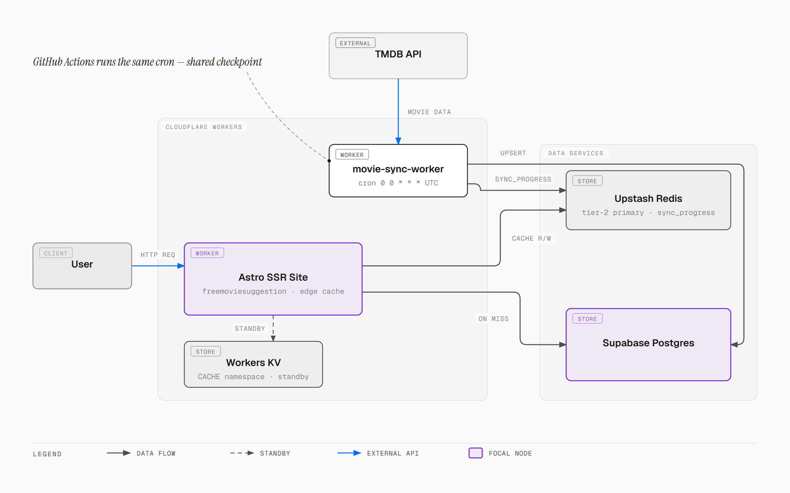
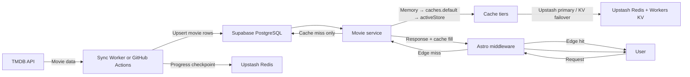
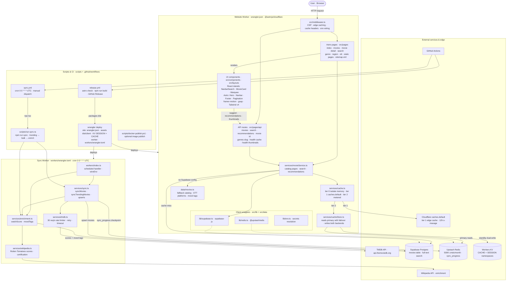

# Free Movie Suggestion

<p align="center">
  <a href="https://astro.build"></a>
  <a href="https://reactjs.org"></a>
  <a href="https://www.typescriptlang.org"></a>
  <a href="https://supabase.com"></a>
  <a href="https://upstash.com"></a>
  <a href="https://workers.cloudflare.com"></a>
  <a href="https://www.themoviedb.org"></a>
  <a href="https://github.com/mdsarfarazalam840/freemoviesuggestion/actions"></a>
  <a href="https://github.com/mdsarfarazalam840/freemoviesuggestion"></a>
</p>

A free-tier-optimized movie suggestion platform built with Astro, React, and Supabase. This tool automatically ingests movie data from TMDB and provides a fast, searchable interface for discovering new movies.


=======


## 📋 Table of Contents

- [Tool Purpose](#-tool-purpose)
- [Tech Stack](#-tech-stack)
- [Architecture](#-architecture)
- [Prerequisites](#-prerequisites)
- [Genie Commands](#-genie-commands)
- [Deployment](#-deployment)
- [Project Structure](#-project-structure)
- [Contributing](#-contributing)
- [License](#-license)

## 🚀 Tool Purpose
The goal of this project is to provide a high-performance, visually appealing movie suggestion site that stays entirely within the free tiers of modern cloud services. It features:
- Automated daily synchronization with TMDB.
- Advanced search and filtering (Postgres Full-Text Search).
- Multi-region support (Hollywood, Bollywood, Tollywood).
- High-performance caching for global speed.

## 🛠 Tech Stack
- **Framework:** [Astro](https://astro.build/) (SSR Mode)
- **Frontend:** [React](https://reactjs.org/) + [Tailwind CSS v4](https://tailwindcss.com/)
- **Animations:** [Framer Motion](https://www.framer.com/motion/), [GSAP](https://greensock.com/gsap/)
- **Database:** [Supabase](https://supabase.com/) (PostgreSQL)
- **Cache:** [Upstash Redis](https://upstash.com/)
- **Deployment:** [Cloudflare Workers](https://workers.cloudflare.com/)
- **Data Source:** [TMDB API](https://www.themoviedb.org/documentation/api)

## 🏗 Architecture
The project follows a **Sync-Store-Serve** architecture:

1. **Sync (background ingestion):** The dedicated Cloudflare sync Worker handles the `0 0 * * *` cron trigger (and an optional `/trigger-sync` request). Each run refreshes trending movies and performs the resumable TMDB bulk sync, upserting movie rows into Supabase first; afterward, enrichment fills missing watch scores and mood tags. The GitHub Actions workflow is a separate runnable entry point for `scripts/run-sync.ts`, with scheduled and manual-dispatch modes.
2. **Store (source of truth and cache backends):** Supabase PostgreSQL is the source of truth for movie metadata and enrichment fields. Sync progress is checkpointed in Upstash Redis. Website response data uses a three-tier read-through cache: short-lived per-isolate memory, Cloudflare `caches.default`, then the metered `activeStore`. Unbounded key spaces skip the metered remote cache tier entirely, while bounded/hot keys use it. In automatic mode, `activeStore` reads Upstash Redis first and fails over to Workers KV only when Upstash errors; writes populate both backends so KV is warm. `CACHE_BACKEND=upstash` or `CACHE_BACKEND=kv` can pin the metered tier.
3. **Serve (edge request path):** Astro middleware normalizes cacheable GET requests and checks the Cloudflare edge cache before rendering. On an edge miss, the movie service checks memory, edge cache, and the active remote store; only then does it query Supabase (or use the local fallback catalog when Supabase is not configured). Middleware response-cache writes and movie-service edge-cache writes are scheduled in the background with the Worker execution context when available; metered remote cache writes are awaited.





📐 **Interactive diagram — opens straight from this README:**

- 🚀 **Live (GitHub Pages):** [**Open the interactive architecture diagram**](https://mdsarfarazalam840.github.io/freemoviesuggestion/architecture-interactive.html) — an explorable view with guided *Serve path*, *Sync path*, and *Cache tier* views (zoom, pan, light/dark). Static render: [`architecture.html`](https://mdsarfarazalam840.github.io/freemoviesuggestion/architecture.html).
- ⚡ **Instant preview (no deploy needed):** [open via htmlpreview](https://htmlpreview.github.io/?https://raw.githubusercontent.com/mdsarfarazalam840/freemoviesuggestion/master/architecture-interactive.html) — renders the file directly from the repository.
- 💾 **Local:** [`architecture-interactive.html`](./architecture-interactive.html) — clone the repo and open it in your browser.

### 📡 Current live-presence architecture

The homepage's **Live now** counter is first-party and D1-first. A visible browser sends a heartbeat every 15 seconds to `POST /api/analytics/track`; the Worker stores the session activity in Cloudflare D1. `GET /api/analytics/live` counts distinct `visitor_id` values seen within the last 45 seconds, so multiple tabs from one browser count as one visitor. Google Analytics 4 Realtime is retained only as a fallback when D1 is unavailable. The public response exposes only an aggregate count and its source.

- **Archify interactive architecture:** [`architecture/live-presence.architecture.html`](./architecture/live-presence.architecture.html)
- **Archify specification:** [`architecture/specs/live-presence.architecture.json`](./architecture/specs/live-presence.architecture.json)
- **Editorial diagram-design view:** [`architecture/live-count-request.architecture.html`](./architecture/live-count-request.architecture.html)

The Archify artifact was validated with the `showcase` profile: 9/9 checks passed, with zero composition errors and zero warnings. The diagram-design artifact passed its SVG accessibility and single-file self-check.

### 🗺️ Extended codebase map

A complete mermaid view of every moving part in the repository — website worker, sync worker, shared services, scripts, and CI:



## ✅ Prerequisites

Before running any commands, ensure you have the following installed:

- **Node.js** >= 22.12.0
- **npm** (ships with Node.js)
- **Wrangler CLI** — installed as a dev dependency (`npx wrangler`)

You'll also need API keys for the following services (see [Environment Setup](#-contribution)):

| Service       | Required For            |
| :------------ | :---------------------- |
| Supabase      | Database & Auth         |
| TMDB          | Movie data ingestion    |
| Upstash Redis | Caching layer           |
| Cloudflare    | Workers deployment      |

##  Genie Commands

All commands are run from the root of the project:

| Command                   | Action                                           |
| :------------------------ | :----------------------------------------------- |
| `npm install`             | Installs dependencies                            |
| `npm run dev`             | Starts local dev server at `localhost:4321`      |
| `npm run build`           | Build your production site to `./dist/`          |
| `npm run preview`         | Preview your build locally, before deploying     |
| `npm run sync`            | Manually trigger movie data synchronization      |
| `npm run sync -- 1000`    | Sync a specific number of movies (e.g., 1000)    |

## 🚀 Deployment

The project has two deployable components deployed on **Cloudflare Workers**: the **sync worker** (TMDB data ingestion) and the **website** (Astro SSR).

### Manual Release

Stable versions are created manually from GitHub Actions using the `Release` workflow.

1. Open **GitHub → Actions → Release → Run workflow**.
2. Select the branch or commit you want to mark as stable.
3. Enter a version tag such as `v1.0.0`.
4. Choose whether it is a prerelease, optionally add notes, then run it.

The workflow installs dependencies, runs `npx astro check`, builds the site with `npm run build`, packages `dist/` as a zip file, and creates a GitHub Release for that tag.

### Sync Worker (TMDB Data Ingestion)

A dedicated Cloudflare Worker (separate from the website) runs daily via Cron Triggers to fetch fresh movie data from TMDB and upsert it into Supabase.

```sh
# Deploy the sync worker
npx wrangler deploy --config workers/wrangler.toml --name movie-sync-worker workers/index.ts

# Tail live sync worker logs
npx wrangler tail --name movie-sync-worker
```

> The worker is already configured with a `cron` trigger (`0 0 * * *`) in [`workers/wrangler.toml`](./workers/wrangler.toml) so it runs automatically every day at midnight UTC after deployment.

### Website (Astro + Cloudflare Workers)

The Astro site uses the `@astrojs/cloudflare` adapter to output an SSR-ready build deployed as a Cloudflare Worker.

```sh
# Build the Astro site
npm run build

# Deploy the website Worker with production routes preserved
npm run deploy


```

> For production, connect your GitHub repository to Cloudflare via automatic CI/CD deployments on every push to `main`.

### First-party analytics (Cloudflare D1)

The website analytics schema is kept in [`migrations/0001_analytics.sql`](./migrations/0001_analytics.sql). D1 setup requires Wrangler authentication and a real database ID from the account that will deploy the website. The root [`wrangler.json`](./wrangler.json) contains the website's `freemoviesuggestion_analytics` binding, database ID, and migrations directory. Run these commands locally when provisioning or updating the database; the migration command is intentionally not run as part of the build:

```sh
# Authenticate Wrangler if this machine is not already authenticated
npx wrangler login

# Create the database and copy the returned database_id
npx wrangler d1 create freemoviesuggestion-analytics

# After adding the binding below, apply migrations remotely
npx wrangler d1 migrations apply freemoviesuggestion-analytics --remote
```

Add the returned `database_id` to the production site configuration in `wrangler.json` (do not use a placeholder in a deployed configuration):

```json
{
  "d1_databases": [
    {
      "binding": "freemoviesuggestion_analytics",
      "database_name": "freemoviesuggestion-analytics",
      "database_id": "<paste-the-database-id-returned-by-wrangler>",
      "migrations_dir": "migrations"
    }
  ]
}
```

The analytics binding belongs to the website Worker; do not add it to `workers/wrangler.toml`, which configures the separate movie-sync Worker. Raw page-view events are intended to be retained for 90 days and should be cleaned up by the analytics cleanup path.

The protected dashboard is available at `/admin/analytics`. Set `ANALYTICS_ADMIN_SECRET` in the website Worker environment. Enter the secret in the dashboard form; it is sent only in the `x-analytics-admin-secret` request header and is never placed in the URL or rendered into page HTML. The summary API returns aggregates only and responds with an unavailable state when D1 is not configured, so movie pages remain useful without analytics.

The homepage live count can optionally prefer GA4 Realtime `activeUsers`. Configure `GA4_PROPERTY_ID`, `GA4_CLIENT_EMAIL`, and `GA4_PRIVATE_KEY` as Worker secrets after enabling the Google Analytics Data API and granting the service account Viewer access to the GA4 property. The browser never receives these credentials or raw Google responses. If GA4 is not configured or unavailable, the endpoint falls back to the D1 five-minute session count.

Raw page-view rows are retained for 90 days. Cleanup is currently manual and best-effort: send an authenticated `POST /api/analytics/cleanup` request with the same header. It removes at most 1,000 expired page views and 1,000 sessions older than 180 days per request, while preserving visitor aggregates used for total visitors. It will remain manual until a real D1 binding and a scheduled Worker trigger are configured; no remote cron is wired here.

Analytics ingestion has a small per-isolate defense-in-depth limit: at most 120 accepted requests per 60-second isolate window, with at most 30 events per visitor per window and a 1-second minimum interval per visitor. These in-memory limits reset when an isolate is replaced and are not a substitute for edge controls. For production, consider Cloudflare edge/WAF rate limiting as an additional distributed control; this implementation does not use raw IP addresses and does not log event payloads. Visitors can opt out before sending an event with `localStorage.setItem('analytics_opt_out','1')` (the client also supports the `analytics_opt_out=1` request opt-out). First-party analytics can coexist with Google Analytics or another consent-managed provider; keep each provider's privacy notice and consent controls accurate and disclose the combined data collection.

## 🤝 Contribution

1. **Clone the repo:**
   ```sh
   git clone https://github.com/your-username/freemoviesuggestion.git
   ```

2. **Set up Environment Variables:**
   Create a `.env` file based on `.env.example`:
   - `PUBLIC_SUPABASE_URL`
   - `PUBLIC_SUPABASE_ANON_KEY`
   - `SUPABASE_SERVICE_ROLE_KEY`
   - `TMDB_ACCESS_TOKEN`
   - `UPSTASH_REDIS_REST_URL`
   - `UPSTASH_REDIS_REST_TOKEN`

3. **Install & Run:**
   ```sh
   npm install
   npm run dev
   ```

4. **Sync Data:**
   Run `npm run sync` to populate your local Supabase instance with movies.

## 🧞 Project Structure

```text
/
├── .github/workflows/ # GitHub Actions (Sync, Release)
├── public/            # Static assets
├── scripts/           # Maintenance & Sync scripts
├── src/
│   ├── components/    # UI Components (Astro & React)
│   ├── data/          # Static data & configurations
│   ├── lib/           # Core library wrappers (Supabase, Redis)
│   ├── pages/         # Route handlers & UI pages
│   ├── services/      # Business logic (TMDB, Cache, Sync)
│   └── styles/        # Global CSS (Tailwind)
└── package.json
```

## 📄 License

This project is open source and available under the [MIT License](LICENSE).
